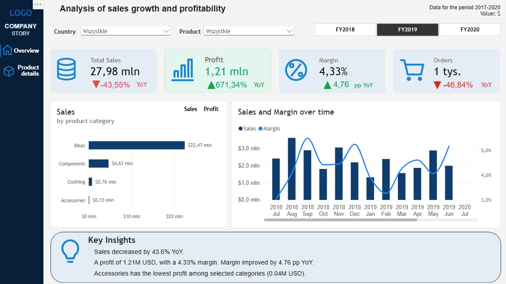
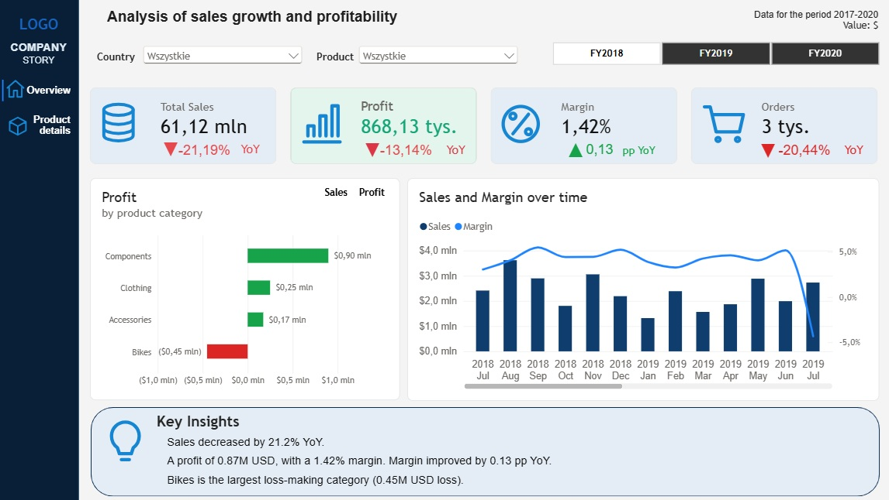
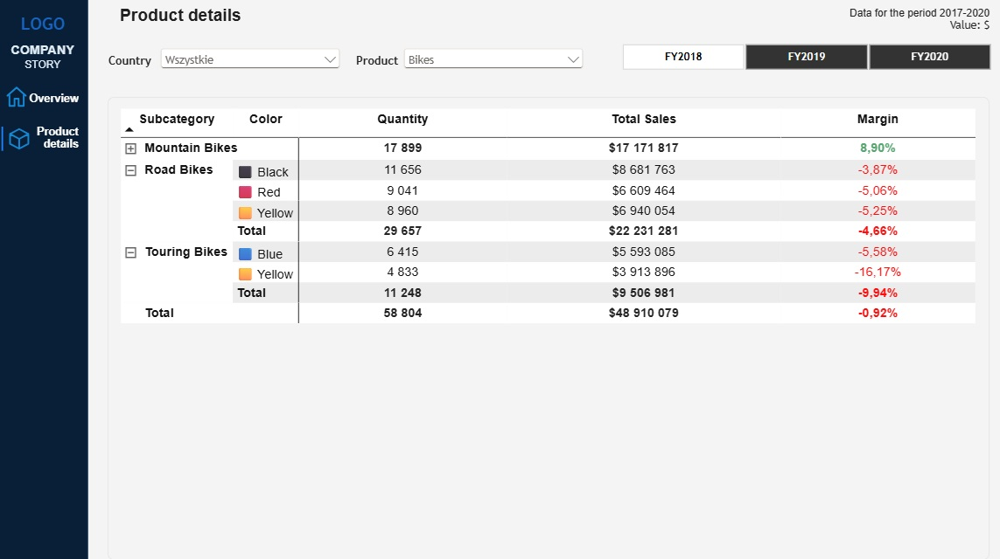

# Sales Performance & Profitability Analysis

**Interactive Power BI dashboard | Data Analytics Portfolio Project**

## Project Overview

This project explores sales performance and profitability through an interactive Power BI report. It helps users monitor revenue, profit, profit margin, and order volume, compare year-over-year performance, and identify profitable and loss-making product categories.

The report covers fiscal years **FY2018–FY2020** and includes filters for fiscal year, country, and product.

## Dashboard Preview

### Overview — Sales and Profitability



### Overview — Category Profit Analysis



### Product Details



## Key Features

- **KPI monitoring:** Total Sales, Profit, Margin, and Orders.
- **Year-over-year comparisons:** Dynamic growth indicators, arrows, and conditional formatting.
- **Sales and profit by category:** Switch between sales and profit views; distinguish gains and losses visually.
- **Sales and margin trends:** Compare monthly sales with margin using a combination chart.
- **Product-level exploration:** Drill into product subcategories and colors with an expandable matrix.
- **Interactive filtering:** Explore results by fiscal year, country, and product.
- **Dynamic business insights:** Automatically updated commentary based on selected filters.
- **Custom navigation:** Move between the Overview and Product Details pages using the sidebar.

## Tools & Techniques

| Tool / Technique | Application |
| --- | --- |
| Power BI Desktop | Dashboard development and visual storytelling |
| Power Query | Data preparation and transformation |
| DAX | KPI measures, YoY calculations, margin analysis, and dynamic insights |
| Data modeling | Relationships between date, sales, and product data |
| Conditional formatting | Performance indicators and profit/loss highlighting |
| Bookmarks and buttons | Interactive view switching and page navigation |

## Example Business Insights

The dashboard can help answer questions such as:

- Which product categories generate the highest sales and profit?
- Are sales and profitability improving year over year?
- Which categories have negative profit margins?
- How does margin change over time?
- How do results differ by country, product, and fiscal year?

> **Note:** Figures shown in the screenshots reflect the selected report filters and are intended as examples of interactive analysis.

## Repository Structure

```text
sales-performance-powerbi/
├── README.md
├── Sales-Performance-Analysis.pbix
└── screenshots/
    ├── Overview1.jpg
    ├── Overview2.jpg
    └── PD.jpg
```

## How to Explore the Report

1. Download the `.pbix` file from this repository.
2. Open it in **Power BI Desktop**.
3. Use the fiscal year, country, and product filters to explore the data.
4. Switch between **Sales** and **Profit** in the category chart.
5. Open **Product Details** to inspect subcategory-level performance.

## Project Goal

To demonstrate practical skills in Power BI dashboard design, DAX, data modeling, interactive reporting, and business-oriented analysis.
